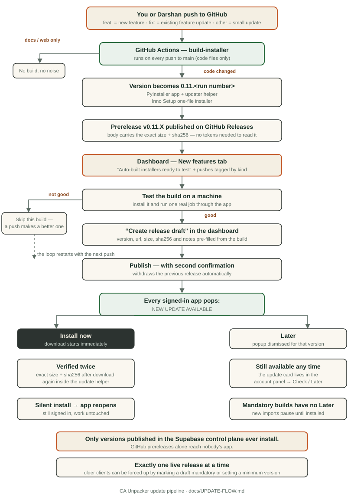
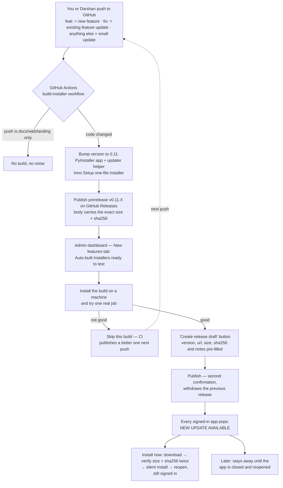

# Update pipeline — how a push reaches every installed app

## Roles

| Step | Who | Where |
| --- | --- | --- |
| Push feature/fix commits | you + Darshan | GitHub `main` (or branches, then merged) |
| Build installer | GitHub Actions (automatic) | `.github/workflows/build-installer.yml` |
| Test the build | founder | a Windows machine with the previous version |
| Publish the release | founder | dashboard `/admin/releases` |
| Receive the update | every signed-in customer | desktop app, `Install now` / `Later` |

## Safety rails

- The app refuses downloads whose **size or SHA-256** does not match the release record — verified again inside the update helper just before installing.
- Only HTTPS links on `github.com` / `objects.githubusercontent.com` / `github-releases.githubusercontent.com` are accepted.
- Prereleases on GitHub never install anywhere: installed apps only take versions **published in the Supabase control plane**.
- Publishing withdraws the previous release automatically, so exactly one is live.
- Mandatory releases (a flagged draft) drop the `Later` button and pause new imports until installed; existing packs stay open.
